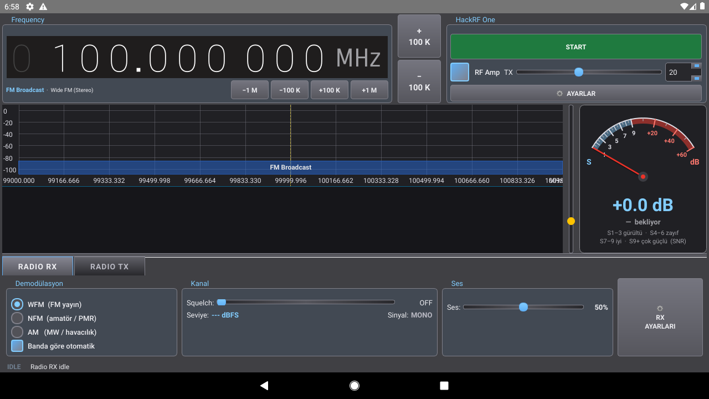
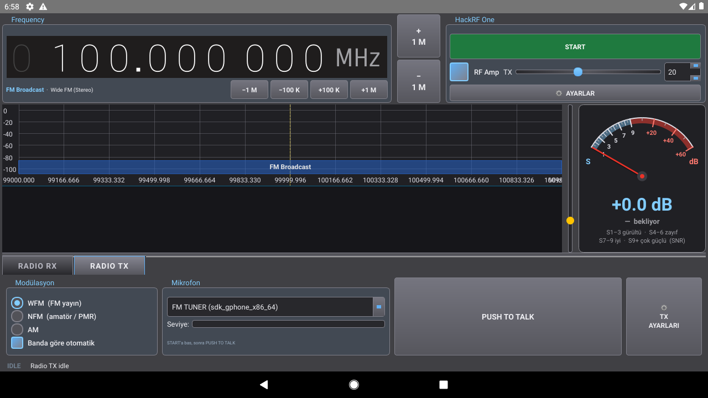
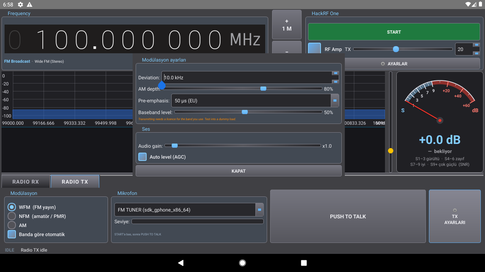
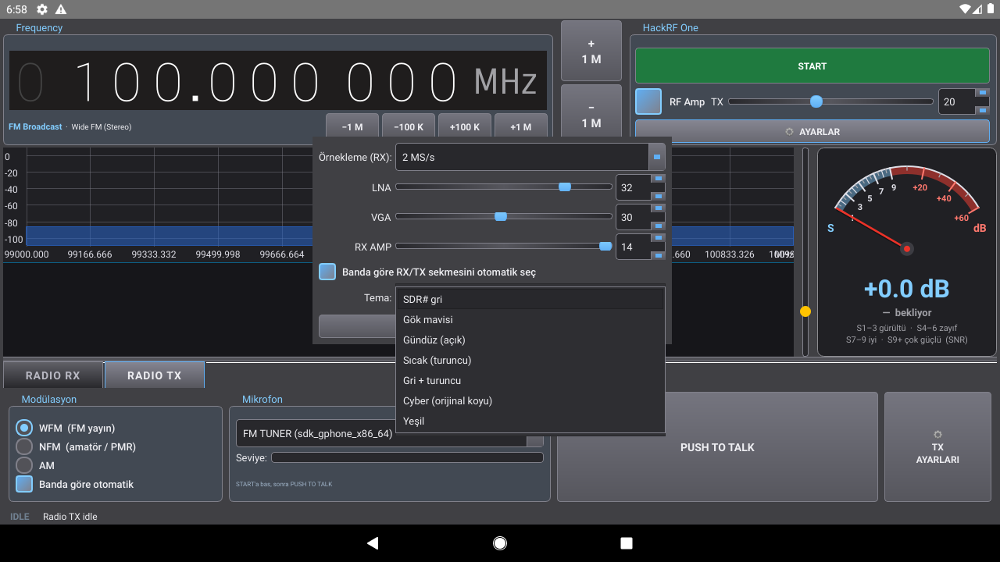

# HackTvTxRx — HackTvStudio

Analogue radio & TV transceiver for the **HackRF One**, built with Qt 6.
One application, four modes on the desktop: FM/AM radio receiver, FM/AM radio
transmitter, PAL-B/G television receiver and analogue television transmitter
(PAL, SECAM, NTSC, MAC…). Everything is compiled into the executable — no MSYS2,
no FFmpeg DLLs, no external SDR libraries.

The same source also builds a **radio-only Android version for car head units**
(1280×720 in-dash screens): big finger-sized controls, spectrum + waterfall on
top, a needle S-meter, and the advanced settings tucked into dialogs.


Based on [hacktv](https://github.com/fsphil/hacktv) by Philip Heron (TV encoder)
and the spectrum / frequency widgets of [gqrx](https://github.com/gqrx-sdr/gqrx).

---

## What is in this repository

| Folder / file | What it is |
|--------|------------|
| [`HackTvStudio/`](HackTvStudio/) | **The main application.** Radio RX, Radio TX, TV RX, TV TX in one window (desktop); Radio RX + TX on Android. Self-contained: libusb, libhackrf and hacktv are vendored and built in. |
| `HackTvStudio-arm64.apk`, `HackTvStudio-armv7.apk` | Ready-to-install Android builds (debug-signed). arm64 for 64-bit head units (e.g. Allwinner T527, Android 13), armv7 for older 32-bit units (e.g. RD9600, Android 8.1). |
| [`PALBDecoder/`](PALBDecoder/) | The original standalone PAL-B/G receiver that HackTvStudio grew out of. Kept as a small, single-purpose reference app (also self-contained). |
| [`PALBDecoderIOS/`](PALBDecoderIOS/) | Legacy iOS/macOS port of the PAL decoder (Xcode project). It expects an IQ-over-TCP server that is no longer part of this repository. |

---

## HackTvStudio

### The window

A persistent top strip, the spectrum / waterfall / S-meter across the full width, and one
tab per mode underneath:

- **Frequency dial** 0 – 6 GHz (click a digit, scroll, or click/drag on the spectrum).
  Beside it: **−1 M / −100 k / +100 k / +1 M** step buttons, and two big **+ / −** buttons
  whose step follows the tuned channel (WFM 100 kHz, airband 25 kHz, NFM 12.5 kHz, AM 10 kHz;
  in TX the digit selected on the dial). Hold them to auto-repeat.
- **Band plan readout** — the tuned band and its usual service, e.g.
  `FM Broadcast · Wide FM (Stereo)` or `UHF TV Band IV/V · Channel E22 (video 479.250 MHz)`.
  With **Auto mode** on, tuning into a TV band switches to the TV receiver, tuning into a
  broadcast / amateur / airband frequency switches to the radio receiver and picks WFM / NFM / AM.
- **HackRF One** group — START/STOP, RF amp, sample rate, 0.5 s raw IQ capture,
  LNA / VGA / RX amp / TX VGA, Auto mode and the **Theme** selector.
- **Spectrum + waterfall** (OpenGL) across the full width. In RX modes it shows the received band,
  in TX modes the baseband being transmitted (TX monitor). The draggable filter box sets the
  receiver bandwidth; the axis switches to MHz for wide (TV) spans. In the TV tabs the display
  docks next to the picture.
- **Needle S-meter** at the right edge of the spectrum. The needle shows **signal-to-noise** of the
  tuned channel (strongest component above the noise floor of the band, independent of the gain
  settings and of the channel width): S1 = noise floor, 5 dB per S unit, **S9 = +40 dB**, then
  +20 / +40 / +60 dB over S9. Under the dial: the value in dB and a plain-language verdict
  (*S1–S3 noise · S4–S6 weak–medium · S7–S9 good · S9+ very strong*). The share of ADC samples at
  the rails is shown as a small footnote only — a strong FM or TV signal at full gain clips a good
  share of samples and still sounds / looks fine.
- **Themes** (`Theme:` on the desktop, ⚙ *Ayarlar* on Android): *SDR# gri* (default, neutral
  greys, white→blue spectrum fill), *Gök mavisi*, *Gündüz (açık)*, *Sıcak (turuncu)*,
  *Gri + turuncu*, *Cyber (orijinal koyu)* — the original deep-navy/cyan look — and *Yeşil*.
  Palette, stylesheet, spectrum, waterfall and S-meter colours switch together; the choice is saved.

### RADIO RX

- WFM (broadcast FM with stereo pilot decoding), NFM, AM.
- Bandwidth from the filter box or the slider; squelch with hysteresis; channel level readout.
- Per-mode presets applied on every mode change (and by *Reset mode defaults*):
  WFM 150 kHz / 50 µs / mod index 1.5 / gain 3.0; **NFM 12.5 kHz / de-emphasis off / mod index 0.4 /
  gain 2.0 / IF noise reduction on** (tuned against a 2 m handheld); AM 10.5 kHz.
- "Follow band plan" picks the demodulator from the tuned band automatically.

### RADIO TX

- WFM (stereo MPX: 19 kHz pilot, 38 kHz DSB-SC, pre-emphasis), NFM, AM.
- Sources: **microphone** with push-to-talk, **audio file** (mp3 / wav / flac / ogg… decoded by Qt),
  **test tone** (desktop; Android is microphone only). Audio gain with optional AGC, input VU meter.
- Deviation (FM, default 10 kHz) / depth (AM), baseband level, TX VGA gain.

### TV RX (PAL-B/G) — desktop

- Real-time PAL-B/G colour decoding at 720×576 from 16 MS/s: synchronous detection, carrier AFC,
  flywheel sync with sub-sample timing, burst-locked chroma with per-line V-switch detection,
  temporal noise reduction, 16:9 / 4:3 display, fullscreen.
- FM sound (5.5 MHz) demodulated alongside the picture.
- **Record to MP4** (H.264 + AAC through the platform encoders) — picture and sound, in sync;
  *Open folder* shows the last recording in Explorer.
- VHF Band I / III and UHF Band IV/V channel tables (E2–E69) with automatic video-carrier offsets.
- Layout: picture top-left with *Video processing* beneath it, spectrum/waterfall and S-meter to
  its right, audio / sync / recording controls in the lower right.

### TV TX — desktop

- All 52 hacktv standards: PAL B/G/I/D/K/M/N, SECAM L/D/K/B/G, NTSC M/I/A, D/D2-MAC,
  405/819/240/30-line systems, Apollo, CBS field-sequential…
- Three sources, each with a live preview of what is being sent:
  - **Test card** in the style of the Philips PM5544, drawn by the app at the encoder's picture size
    (circle kept inside the TV overscan) with a **24 h clock with seconds** redrawn every second.
    Sound: quiet time pips each minute (default), silence, or a 1 kHz tone.
  - **Video file** (mp4 / mkv / avi…, decoded by Qt Multimedia, optional loop) with a **seek bar**
    and elapsed / total time; dragging the bar jumps the running transmission.
  - **USB camera** (live) with the camera's own microphone, picked automatically or chosen from the
    list; the camera list follows USB plug/unplug.
- Options: VSB output filter, colour, audio, A2 stereo, NICAM, ACP, VITS, VITC, WSS, teletext,
  Videocrypt I/II/S and Syster scrambling, output level.
- **Teletext**: point the field at a folder of `.tti` pages, or press **Info pages** to generate
  page 100 with the frequency, channel, standard, picture format, sound, source and start time
  (refreshed on every START). The page header carries a live date/time clock.


### Supported hardware

HackRF One only (1 MHz – 6 GHz, half-duplex: one mode at a time).
On Windows the HackRF must be bound to the **WinUSB** or **libusbK** driver (use
[Zadig](https://zadig.akeo.ie/)); on Linux install hacktv's `53-hackrf.rules` udev rule.
On Android the HackRF is driven through USB host / OTG (USB permission is asked on first start).

---

## Android (car head unit)

The Android build is **radio only** (Radio RX + Radio TX); the TV encoder/decoder is left out
of the APK. It was laid out for a 1280×720, 160 dpi in-dash screen operated by finger:



- Top strip: big frequency dial, step buttons, the finger **+ / −** pair (step follows the channel
  width, label shows the current step), and a compact HackRF box — big START, RF Amp, TX gain and
  the **⚙ Ayarlar** button.
- **⚙ Ayarlar** dialog: sample rate, LNA / VGA / RX AMP, "auto RX/TX tab from band" and the
  **Tema** (theme) list.
- Spectrum + waterfall fill the width; the needle S-meter sits at the right.
- One compact control row per tab. **Radio RX**: demodulation (WFM / NFM / AM, follow band),
  squelch + level + stereo indicator, volume, and **⚙ RX ayarları** (bandwidth, audio gain,
  de-emphasis, mod index, noise reduction, force mono, reset presets).
  **Radio TX**: modulation, microphone selection + input level, a big **PUSH TO TALK** and
  **⚙ TX ayarları** (deviation, AM depth, pre-emphasis, baseband level, audio gain, AGC).
  TX is microphone only on Android.
- Default start: 100.000 MHz, 2 MS/s, *SDR# gri* theme.







### Installing

`HackTvStudio-arm64.apk` for 64-bit units (Android 13 / API 33 head units such as the Allwinner
T527), `HackTvStudio-armv7.apk` for 32-bit units (Android 8.1 / API 27, e.g. Allwinner T3 RD9600).
Both are debug-signed with the same key, so one can be updated over the other. Enable
"unknown sources", install, plug the HackRF into the USB/OTG port and press START.

### Emulator notes

On an x86 PC the Android emulator cannot run the arm64 APK (no arm64 system images on x86 hosts,
and the ARM-translation layer of the API 30 Play images lacks an instruction used by Qt).
The **armv7** APK does run on an API 30 Google Play x86_64 image (ARM translation), which is how
the screenshots above were taken (AVD: 1280×720, 160 dpi).

---

## Architecture

```
RX:  USB callback ──► lock-free ring ──► RxEngine thread ──► mode sink (own worker threads)
                                              │                 TV: PAL decoder, audio demod
                                              └──► FFT 25 Hz ──► spectrum / waterfall / S-meter
TX:  mic / file / tone ──► RadioModulator ─────────────────┐
     file (QMediaPlayer) / USB camera (QCamera + mic) /    │
     test card (QPainter + clock) ──► QtAvSource ──► hacktv encoder ─┴──► TxEngine ──► ring ──► USB callback
```

- The libusb/libhackrf USB callback never does DSP (RX: write to ring, TX: copy from ring).
- The GUI thread never does DSP; it receives spectra and frames through queued signals.
- Each mode is a `ModePanel`; `StudioWindow` owns the device, the two engines and the display.
  A panel may offer a *spectrum slot*; the main window docks the plotter there while the panel is active.
- Desktop and Android share one source tree. Platform differences are `#ifdef Q_OS_ANDROID` in
  `StudioWindow`, `RadioRxPanel` and `RadioTxPanel` (layout, labels, defaults); the TV panels and
  the hacktv/tv sources are excluded from the Android build in the `.pro` (`!android { … }`).
- The PAL decoder runs block-wise with SSE2 helpers (≈30 ms per 40 ms frame at 16 MS/s, bit-identical
  to the original per-sample implementation); the offline benchmark is in `HackTvStudio/tools/palbench/`.
- `QtAvSource` feeds hacktv through its `av_t` callbacks from three inputs (file, camera, still
  picture); the encoder takes the newest frame for every TV frame and pulls 32 kHz stereo audio from a ring.

### Layout of `HackTvStudio/`

```
core/       DeviceController (HackRF owner), RxEngine, TxEngine, SpscRing, Fft, BandPlan, SimdDot
ui/         StudioWindow, RadioRxPanel, RadioTxPanel, TvRxPanel, TvTxPanel, TvRecorder, VideoView,
            Theme (colour themes: palette + stylesheet + plot colours)
dsp/        fmdemodulator, amdemodulator (RX), RadioModulator (TX)
tv/         QtAvSource (file / camera / still -> hacktv), TvTxEncoder (hacktv wrapper),
            TestCard (PM5544-style card), TeletextPages (.tti generator)        [desktop only]
hacktv/     fsphil's hacktv encoder sources (C), without the FFmpeg / RF backends
hackrf/     HackRfDevice wrapper around libhackrf
widgets/    CPlotter (spectrum/waterfall), CFreqCtrl, CMeter (from gqrx), AnalogMeter (needle S-meter)
android/    AndroidManifest.xml, USB device filter, Java activity for USB permission
3rdparty/   libusb 1.0.27, libhackrf, MSVC compatibility shims
build_android.ps1   Android build script (see below)
PALDecoder.cpp/.h, audiodemodulator.cpp/.h, audiooutput.cpp/.h   PAL-B/G receiver DSP
```

---

## Building

### Desktop

Requirements: **Qt 6.8+** (tested with 6.11.1) with the Multimedia and OpenGL Widgets modules,
a C++17 compiler. Nothing else — libusb, libhackrf and hacktv are part of the source tree.

**Windows** — open `HackTvStudio/HackTvStudio.pro` in Qt Creator with either kit and build **Release**:

- **MSVC 2022 64-bit** — recommended; MP4 recording uses the Windows Media Foundation encoders.
- **MinGW 64-bit** — also supported.

Both kits build without MSYS2. The only runtime dependencies are the Qt DLLs (`windeployqt`).

**macOS / Linux**

```bash
cd HackTvStudio
qmake HackTvStudio.pro CONFIG+=release
make -j
```

libusb's IOKit (macOS) and usbfs/netlink (Linux) backends are compiled in; the only system
dependencies are the OS frameworks (macOS: IOKit, CoreFoundation, Security) and pthread (Linux).
These targets build from the same sources but have not been exercised as much as Windows.

### Android

Requirements: a Qt for Android kit, the Android SDK (platform 33, build-tools 34) and NDK.
Use **Qt 6.5.3** for head units that still run Android 8.1 (API 27) — Qt 6.8+ needs API 28.

```powershell
cd HackTvStudio
.\build_android.ps1 arm64 -QtVer 6.5.3        # or: armv7
```

The script runs qmake + make for the ABI, then packages the APK with Gradle (it patches the
generated `gradle.properties` to compile SDK 33 / build-tools 34 for Qt 6.5). `-SoOnly` stops after
the native `libHackTvStudio_<abi>.so`, which can be swapped into an existing signed APK (zipalign +
apksigner with the debug key) when Gradle is not wanted.

### PALBDecoder

Same procedure with `PALBDecoder/PALBDecoder.pro` (Windows kits only).

---

## Using it

1. Plug in the HackRF, start HackTvStudio.
2. Type a frequency into the dial, use the **+ / −** buttons, or click on the spectrum. With
   *Auto mode* on, the right tab and demodulator are chosen for you: `100.000 MHz` → Radio RX / WFM,
   `145.500 MHz` → NFM, `119.100 MHz` → AM, `479.250 MHz` → TV RX (desktop).
3. Press **START**. Watch the S-meter: S7–S9 is a good signal. If the small *ADC kırpma* note under
   it grows large and the audio/picture suffers, lower LNA/VGA or switch the RF amp off.
4. To transmit, open RADIO TX (or TV TX on the desktop), choose a source and press START.
   Transmitting needs a licence for the band you use; start with a low TX VGA value and a dummy load.
5. For a TV test (desktop), pick an unused UHF channel (look for an empty 8 MHz in the TV RX
   spectrum), select the test card, press START and tune the television to that channel. Press TEXT
   and enter 100 for the info page.

Settings (frequency, gains, theme, every panel's controls) are saved on exit and restored.

---

## Licenses

- Application code: GPL-3.0 (it links hacktv and gqrx code).
- `HackTvStudio/hacktv/` — hacktv, © Philip Heron, GPL-3.0.
- `HackTvStudio/widgets/` — gqrx / CuteSDR, GPL-3.0.
- `HackTvStudio/3rdparty/libusb/` — LGPL-2.1 (sources included, relinking possible).
- `HackTvStudio/3rdparty/libhackrf/` — BSD-3, © Great Scott Gadgets.

See [LICENSE](LICENSE) and the headers of the individual files.
